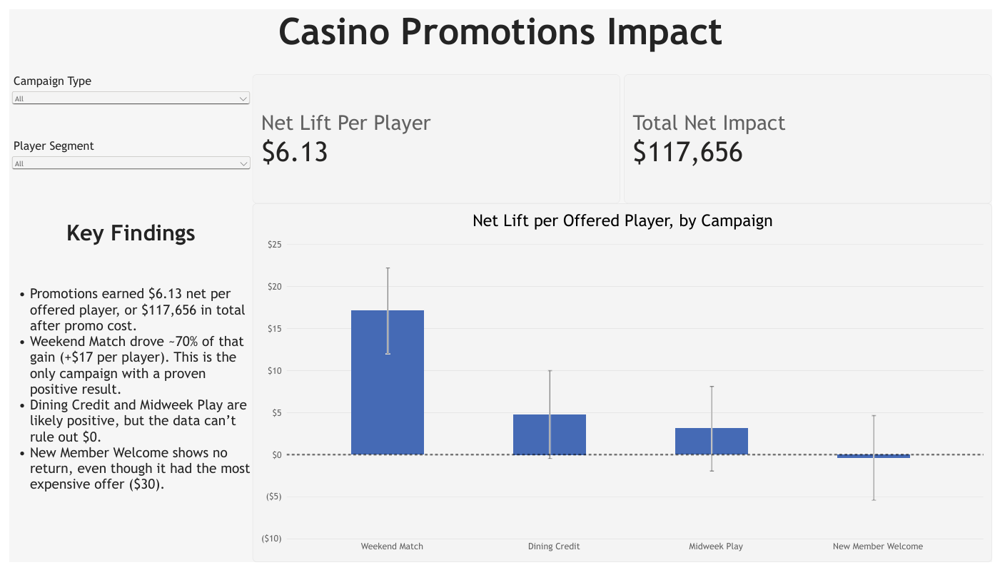

# Casino Promotion Performance

The main goal of this project was to compare the success, or failure, of four casino promotions. A Python pipeline loads, validates and cleans the raw data, then calculates how players who received an offer compared with players who were held out. A Power BI report presents the results.



## Run it

Requires Python 3.11+ (built with 3.15).

```
git clone https://github.com/garrettdaily/casino-promo.git
cd casino-promo
py -m venv .venv
.venv\Scripts\Activate.ps1        # Mac/Linux: source .venv/bin/activate
pip install -r requirements.txt
python run_pipeline.py
```

A successful run ends with:

```
Done. Wrote 6 tables to data/output/
  Raw checks failing:       16 of 21
  Records in data-quality log: 15
  Players analyzed:         23,999
  Net lift per offered player: $6.13 (95% CI $3.58 to $8.68)
```

The report is `PowerBI/GarrettDaily_CasinoProject.pbix`, or `docs/GarrettDaily_CasinoProject.pdf` without Power BI. To refresh it from your own run, set the `DataFolder` parameter (Transform data → Edit parameters) to your `data/output` folder.

## Questions

1. Did the promotions pay off after the cost of the offers?
2. Who came back, and who redeemed?
3. How confident can we be in each result?

## Findings

| Campaign | Net gain per offered player | 95% range | Verdict |
|---|---|---|---|
| Weekend Match | $17.08 | $11.97 to $22.18 | Positive |
| Dining Credit | $4.75 | -$0.48 to $9.99 | Inconclusive |
| Midweek Play | $3.07 | -$1.96 to $8.10 | Inconclusive |
| New Member Welcome | -$0.38 | -$5.41 to $4.64 | Inconclusive |
| All campaigns | $6.13 | $3.58 to $8.68 | Positive |

The promotions paid off: about $118K after promo cost. Weekend Match, the cheapest offer, earned 70% of it and was positive in every player segment. New Member Welcome, the most expensive offer, earned nothing measurable. Dining Credit and Midweek Play are probably positive, but their ranges include $0.

Offered players came back more (56% vs. 47%), and 1 in 4 used their offer. Both groups played the same before the campaigns ($68.19 vs. $67.74 per player), so the comparison is fair.

## Pipeline

```
data/raw → load → check → clean → check again → model → analyze → data/output → Power BI
```

| Step | File | What it does |
|---|---|---|
| Load | `src/load.py` | Reads the three CSVs with explicit data types |
| Check | `src/checks.py` | Runs 21 data-quality rules and reports every failure |
| Clean | `src/clean.py` | Applies the decisions in `Decisions.md` and logs every record it touches |
| Model | `src/model.py` | Builds `player_summary`, one row per player |
| Analyze | `src/analyze.py` | Calculates offer vs. holdout differences with 95% confidence intervals |
| Run | `run_pipeline.py` | Runs every step in order with one command |

Raw files are never modified. Every run rebuilds the output from scratch and produces identical results.

## Automated validation

The data is validated automatically on every run. Nothing reaches the report unless it passes.

- **Schema check on load.** If a file is missing a column or has an unexpected one, the run stops.
- **21 data-quality rules, run twice.** `checks.py` tests the raw data for duplicates, conflicting records, orphaned IDs, invalid redemptions, negative costs and out-of-window dates. The same rules run again on the cleaned data.
- **Errors block output.** If any error-level check still fails after cleaning, the pipeline stops before writing a single file. Warnings are allowed but reported.
- **Reconciliation after modeling.** `model.py` confirms there is exactly one row per player and that revenue, cost and redemption totals match the cleaned source tables. Any mismatch stops the run.
- **Report reconciled to the pipeline (manual check).** Power BI row counts, relationships and headline measures were checked against the Python results.

On this data, the raw files failed 16 of 21 checks. After cleaning, 0 errors remain and one allowed warning. Every fix is written to `data/output/dq_log.csv`, and the reasoning for each is in [Decisions.md](Decisions.md).

## Data model

The pipeline writes six tables to `data/output/`. The Power BI model uses four of them:

- **Player Summary** is the center: one row per player, with group, campaign, segment, and activity before and during the response window.
- **Visits** and **Redemptions** relate to Player Summary on `player_id` and `assignment_id`.
- **Campaign Results** holds the pre-calculated results and confidence intervals. It is not related to the other tables.

Every table, column and measure has a description, and the Data Dictionary page lists them all. `PowerBI/casino_promo_model.tmdl` builds the base model as code. Final formatting was done in Power BI Desktop and is saved in the `.pbix`.

## Assumptions and trade-offs

- **Everyone offered vs. everyone held out.** Assignment was randomized, so this comparison measures what the offer caused. Comparing redeemers to non-redeemers would have shown +$73 per player, but redeemers were already better customers before the campaign.
- **Players stay in their assigned group**, including the one held-out player who redeemed. Moving them would bias the comparison.
- **Net gain is gaming revenue in the 14-day window minus promo cost.** Players who didn't redeem cost $0.
- **The 28-day pre-period is a balance check, not a before/after comparison.** The two periods are different lengths.
- **Exclude rather than guess.** When a record couldn't be verified, it was left out (2 of 24,001 players).
- **Statistics are calculated in Python, not DAX.** They are tested and version-controlled, but confidence ranges exist only for the breakdowns I calculated.

## How I used AI

I used Claude to write most of the Python and the Power BI model script. I made the decisions: which stack to use, how to handle each data problem, which comparison to trust (everyone offered vs. everyone held out, instead of redeemers vs. non-redeemers), what to keep in the model, and what to show. I checked every result against expected numbers and built the report myself. I also used AI to help me understand the data and the code, and to draft most of this README.

## What I'd improve next

- **Test the code, not just the data.** The pipeline validates the data on every run, but nothing checks that the cleaning rules themselves still work after someone changes them. I'd add unit tests for each rule using small sample datasets, and run them automatically with GitHub Actions on every push.
- **Alert someone when a run fails.** Right now a failed check stops the pipeline, but only the person running it sees the error. In a real environment I'd schedule the pipeline and send a notification when it fails, so problems are caught before anyone opens the report.
- **Build my own Python fluency.** AI helped me move fast in a language I'm still learning. Next, I want to get to where I can read, debug and change code like this on my own, so AI speeds me up rather than explains things to me.

## Project structure

```
casino-promo/
├── data/raw/          Source CSVs (never modified)
├── data/output/       Pipeline output (generated, not in Git)
├── src/               Pipeline steps
├── run_pipeline.py    Runs the pipeline
├── Decisions.md       Data-quality decisions
├── PowerBI/           Report (.pbix) and model script (.tmdl)
├── docs/              Report PDF and screenshots
└── requirements.txt   Python package versions
```
